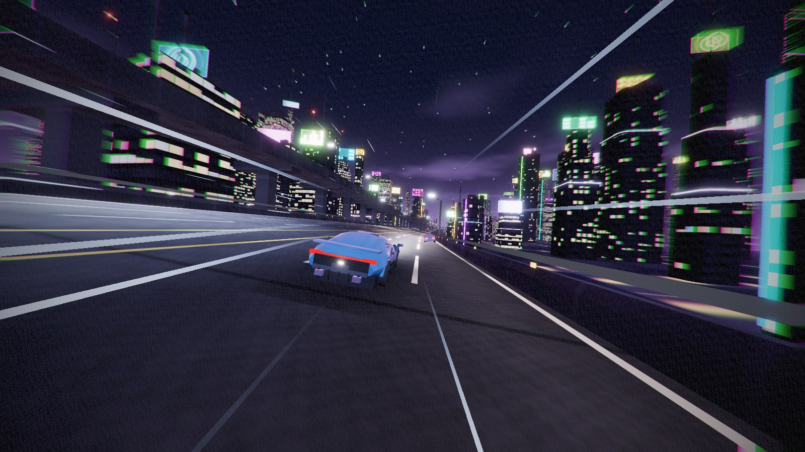
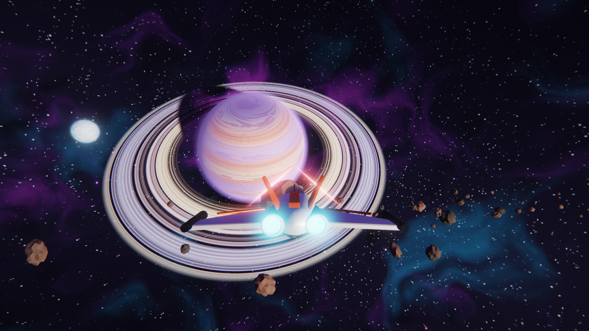
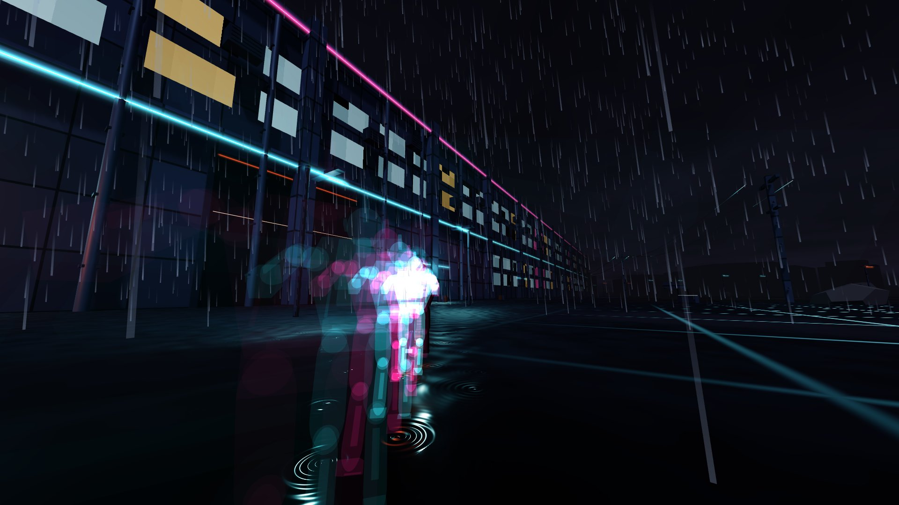

# Random HTML Games

Browser games that live in **one HTML file each**. No installs, no build step, no asset downloads —
open the file and it plays. Everything is generated at runtime in code.

### **[▶ Play them here](https://alekholt.github.io/random-html-games/)**

---

## Games

| Game | What it is | Built with | |
| --- | --- | --- | --- |
| **[Neon Run](neon-run/)** | Endless night-city highway racer with two drivable tiers of elevated expressway, procedural city and cars, and synthesised engine audio | WebGL · three.js | [▶ Play](https://alekholt.github.io/random-html-games/neon-run/) |
| **[Voidwake](voidwake/)** | No Man's Sky–style space explorer: a vast ten-body system with a pulse drive and system map, shader-generated planets and city worlds with analytic atmospheres, seamless landings, surface mining and a synthesised ambient soundtrack | WebGL · three.js · Tailwind | [▶ Play](https://alekholt.github.io/random-html-games/voidwake/) |
| **[Nullpoint](nullpoint/)** | Textless neo-noir explorer: a streamed 500 m neon monolith and outposts in a rain-soaked desert, three hidden anomaly cores, secrets, articulated NPCs and procedural audio | WebGL · three.js | [▶ Play](https://alekholt.github.io/random-html-games/nullpoint/) |

[](neon-run/)

[](voidwake/)

[](nullpoint/)

---

## How this repo is laid out

```
random-html-games/
├── index.html          ← landing page (BUILT from site/, don't edit by hand)
├── site-assets/        ← landing page JS/CSS (built)
├── site/               ← landing page source: Vite + React + Tailwind + Magic UI
├── LICENSE
├── Game Tester - Helios/  ← QA agent: reviews, bug IDs, test requests
├── Designer - Phobos/     ← design agent: style guide, 3D models, model viewer, design requests
└── <game-name>/
    ├── index.html      ← the entire game, one file
    ├── README.md       ← controls, how it works
    └── screenshots/
```

Each game is fully self-contained in its own folder, so you can download a single `index.html`
and it still works. The games never depend on the landing page or its build.

The landing page is the only part with a build step. It gives each game a full-screen page with a
screenshot carousel, description and a themed animated scene, a collapsible sidebar to jump between
games, and a site theme that cross-fades to the game you're looking at. It builds straight into the
repo root, so GitHub Pages keeps serving the repo as it is.

### Adding a game

1. Drop it in a new folder as `<game-name>/index.html`, with its own `README.md` and `screenshots/`
   (16:9 shots, about 1600×900, work best on the landing page).
2. Add an entry to `site/src/games.ts` (title, copy, screenshots, theme colours) and a scene in
   `site/src/components/scenes/`, then register the scene in `site/src/App.tsx`.
3. Rebuild the landing page: `cd site && npm install && npm run build`. Commit the updated
   `index.html` and `site-assets/`.
4. Add a row to the table above.

## Running locally

```bash
git clone https://github.com/AlekHolt/random-html-games.git
cd random-html-games
python3 -m http.server 8000
```

Then open <http://localhost:8000/>. Individual games also work by opening their `index.html`
directly from the filesystem.

To work on the landing page with hot reload: `cd site && npm install && npm run dev`.

## License

MIT — see [LICENSE](LICENSE).
